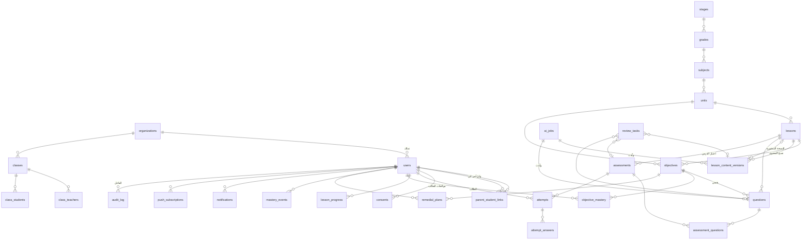

# قاعدة بيانات الـMVP — مشرق

> المخطّط القابل للتشغيل: [`schema.sql`](schema.sql) (PostgreSQL 15+). جُرِّب على PostgreSQL فعلي: ٣٣ جدولًا، و٣١ فحصًا للقيود نجحت كلها.

## ١. النطاق والافتراضات

**النطاق:** ميزات المرحلة ١ في وثيقة المنتج (١٦ ميزة)، مع أربع إضافات لا يصحّ إطلاق منتج يجمع بيانات أطفال من دونها:

| من الوثيقة (المرحلة ١) | مضاف إلى الـMVP |
|---|---|
| F1.1 هيكلة المنهج · F1.2 إدارة المحتوى · F1.3 الشرح · F1.4 التلخيص | F11.4 الموافقات (الوثيقة: مرحلة ٣) |
| F2.1 اختبار بعد كل درس · F2.3 أنواع الأسئلة · F2.4 التصحيح والتغذية الراجعة | F11.1 خصوصية القُصّر وطلبات البيانات (مرحلة ٣) |
| F4.1 رئيسية الطالب · F4.2 خوض الدروس والاختبارات | F10.5 سجلّ التدقيق (مرحلة ٣) |
| F5.1 متابعة الأبناء · F5.2 التقارير والتنبيهات | F3.4 تتبّع الإتقان + خطة علاجية مبسّطة (مرحلة ٢) |
| F6.1 الفصول · F6.2 اعتماد المحتوى المولّد | |
| F10.2 الصلاحيات · F11.2 المصادقة · F12.2 العربية | |

**الافتراضات:**

- **PostgreSQL**، كما في وثيقة المنتج. المخطّط محايد تجاه الخادم (Laravel أو غيره): جداول بالجمع وsnake_case، ومفاتيح uuid.
- **يدعم المسارين**: أفراد (B2C) ومدرسة تجريبية. كل البيانات تحت `org_id` من اليوم الأول، فإضافة المدارس لاحقًا لا تتطلّب إعادة هيكلة.
- **الأدوار في الـMVP أربعة**: طالب، وليّ أمر، معلّم، مدير (admin). الإشراف التربوي ومدير النظام متعدّد الجهات في المرحلة ٣.
- **القيم المحدودة نصّ مع CHECK** بدل ENUM: إضافة قيمة جديدة (مثل نوع سؤال «مقالي») تعديل قيد واحد، لا ترحيل نوع.

## ٢. مخطّط الكيانات

## ٣. الجداول حسب المجال

### الهوية والصلاحيات (٦ جداول)

| الجدول | الغرض | ملاحظات التصميم |
|---|---|---|
| `organizations` | «مشرق» نفسها للأفراد، ومدرسة لاحقًا | صفّ واحد في الـMVP |
| `users` | كل المستخدمين بأدوارهم | وسيلة دخول واحدة على الأقل: جوال (E.164) أو بريد أو اسم مستخدم. الطالب القاصر غالبًا باسم مستخدم ينشئه وليّ أمره. `birth_date` يحدّد القاصر |
| `parent_student_links` | وليّ الأمر ↔ أبناؤه (متعدد لمتعدد) | الدور مضمون في القاعدة عبر مفتاح أجنبي على `(id, role)`: لا يمكن ربط معلّم كوليّ أمر |
| `consents` | موافقات وليّ الأمر | **سجلّ إلحاقي** مع نسخة السياسة. الحالة الحالية من العرض `current_consents` (آخر قرار لكل نوع) |
| `auth_otp_codes` | رموز التحقق بالجوال | الرمز مُجزّأ لا نصًّا، وحدّ ٥ محاولات في القاعدة |
| `auth_sessions` | جلسات الدخول | رمز التحديث مُجزّأ، وإبطال الجلسة بـ `revoked_at` |

### المنهج والمحتوى (٧ جداول)

`stages → grades → subjects → units → lessons`، و`objectives` (أهداف التعلّم) مرتبطة بالوحدة والدرس. الهدف هو **وحدة القياس** للإتقان والفجوات.

**`lesson_content_versions` هو قلب «الإنسان في الحلقة»:** كل شرح أو ملخّص يولّده الذكاء الاصطناعي أو يعدّله المعلّم يُحفظ **نسخةً جديدة** بحالة `pending`. الدرس يشير إلى النسخة المنشورة (`published_content_id`)، والقاعدة ترفض نشر درس بلا نسخة. النتيجة:
- لا يرى الطالب أي محتوى لم يعتمده معلّم.
- تاريخ كامل لكل نسخة: من ولّدها، ومن اعتمدها، ومتى.
- التراجع إلى نسخة سابقة تحديث واحد.

الشرح بمستوياته الثلاثة والأمثلة والملخّص والبطاقات في حقول `jsonb` داخل النسخة، لأنها تُقرأ وتُعتمد وتُنشر معًا دائمًا.

### «النجمة» (جدول واحد)

`ai_jobs`: كل طلب توليد، بالنموذج ونسخة الموجّه (prompt) والرموز (tokens) والكلفة. يخدم ثلاثة أغراض: حوكمة الكلفة الشهرية، وربط كل محتوى بمصدره، وقياس أثر تغيير الموجّهات على الجودة.

### بنك الأسئلة والاختبارات (٥ جداول)

| الجدول | ملاحظات |
|---|---|
| `questions` | أربعة أنواع في الـMVP: اختيار من متعدد، صح/خطأ، إكمال، مطابقة (كلها تُصحَّح آليًّا بدقة). المقالي في المرحلة ٢. تفاصيل السؤال في `payload` (jsonb)، وتفسير الإجابة في `explanation`. لكل سؤال `version` |
| `assessments` + `assessment_questions` | مجموعة أسئلة يعتمدها المعلّم كاختبار درس. **اختبار معتمد واحد فقط لكل درس** (فهرس فريد جزئي). يدعم امتحان الوحدة للمرحلة ٢ دون تغيير |
| `attempts` | محاولة الطالب. القاعدة ترفض محاولة لغير طالب، ومحاولة «مُسلَّمة» بلا درجة. `client_id` يمنع تكرار المحاولة إن أعاد التطبيق إرسالها بعد انقطاع الاتصال (PWA) |
| `attempt_answers` | إجابة كل سؤال مع `question_version`، فيبقى التصحيح صحيحًا ولو عُدّل السؤال لاحقًا |

### التقدّم والإتقان (٤ جداول)

| الجدول | ملاحظات |
|---|---|
| `lesson_progress` | حالة كل درس للطالب، وآخر مستوى شرح اختاره، وأفضل درجة |
| `objective_mastery` | **القيمة الحالية** لإتقان كل هدف (٠–١٠٠). فهرس جزئي للفجوات (أقل من ٧٠) لأن «فجوات الطالب» أكثر استعلام يتكرّر |
| `mastery_events` | تاريخ كل تغيّر في الإتقان ومن أي محاولة. منه يُرسم منحنى التقدّم، وبه نفسّر أي رقم يراه وليّ الأمر |
| `remedial_plans` | إعادة شرح ← تمارين ← إعادة اختبار. **خطة مفتوحة واحدة فقط لكل (طالب، هدف)**، والإغلاق يتطلّب سببًا |

### الفصول والاعتماد (٤ جداول)

`classes` و`class_teachers` (المعلّم + المادة) و`class_students`. في مسار الأفراد يمكن أن تكون «الفصول» مجموعات يتابعها معلّمو مشرق.

`review_tasks`: طابور اعتماد المعلّم. كل مهمّة تشير إلى **شيء واحد فقط** (نسخة محتوى، أو اختبار، أو سؤال)، والقاعدة تفرض ذلك.

### الإشعارات (جدولان)

`notifications` (داخل التطبيق، مع فهرس لغير المقروء) و`push_subscriptions` (اشتراكات Web Push للـPWA).

### الامتثال (٣ جداول)

| الجدول | ملاحظات |
|---|---|
| `audit_log` | **إلحاقي**: trigger يرفض أي تعديل أو حذف. كل إجراء حسّاس (اعتماد، رفض، سحب موافقة، تعليق حساب) |
| `data_requests` | طلبات أصحاب البيانات وفق نظام حماية البيانات الشخصية: تصدير، حذف، تصحيح. صاحب البيانات قد يختلف عن مقدّم الطلب (وليّ الأمر عن ابنه) |
| `leads` | طلبات التواصل من الصفحة الرئيسية (بديل KV في `docs/deploy/leads-worker.js` عند وجود الخادم) |

### اختياري: الحضور

`attendance_records` موجود في المخطّط لكنه **ليس من MVP الوثيقة** (مرحلة ٢). يُستخدم فقط إن بدأنا بمدرسة تجريبية.

## ٤. قواعد تفرضها القاعدة نفسها

كل قاعدة هنا جُرِّبت فعليًّا (`31 passed, 0 failed`):

- مستخدم بلا أي وسيلة دخول، أو جوال بغير الصيغة الدولية → مرفوض.
- ربط مستخدم غير وليّ أمر كوليّ أمر، أو محاولة اختبار لغير طالب، أو إضافة غير معلّم كمعلّم فصل → مرفوض.
- نشر درس بلا نسخة محتوى → مرفوض.
- اعتماد أو رفض بلا وقت قرار → مرفوض.
- اختبار معتمد ثانٍ للدرس نفسه → مرفوض.
- محاولة مُسلَّمة بلا درجة، أو المحاولة نفسها مرّتين من الجهاز → مرفوض.
- إتقان خارج ٠–١٠٠، أو خطة علاجية مفتوحة ثانية للهدف نفسه، أو إغلاق خطة بلا سبب → مرفوض.
- مهمّة اعتماد تشير إلى أكثر من شيء → مرفوض.
- تعديل سجلّ التدقيق أو الحذف منه → مرفوض.

## ٥. ما يبقى في طبقة التطبيق

| القاعدة | المكان | المصدر في النموذج الحالي |
|---|---|---|
| حساب الإتقان: `قديم × 0.55 + جديد × 0.45` | الخادم، عند تسليم المحاولة، في معاملة (transaction) واحدة مع `mastery_events` و`remedial_plans` | `updateMastery` في `src/lib/grading.js` |
| الفجوة أقل من ٧٠ تفتح خطة، والإتقان ٨٠ فأكثر يغلقها | الخادم | `GAP_THRESHOLD` و`CLOSE_THRESHOLD` |
| الطالب القاصر لا يُفعَّل قبل موافقة `data_processing` | الخادم عند التفعيل | — |
| إرسال الإشعار بعد كل حدث (درس منجز، فجوة، تقرير أسبوعي) | طابور مهام | `note()` في المخزن |
| تسجيل كل إجراء حسّاس في `audit_log` | وسيط (middleware) في الخادم | `audit()` في المخزن |

## ٦. صلاحيات الوصول حسب الدور

تُطبَّق في الخادم (سياسات Laravel أو ما يقابلها)، ويمكن تعزيزها بـ Row Level Security في PostgreSQL كخطّ دفاع ثانٍ.

| الدور | يقرأ | يكتب |
|---|---|---|
| الطالب | محتواه المنشور، محاولاته، إتقانه، خططه، إشعاراته | محاولاته، تقدّمه، خطوات خطته |
| وليّ الأمر | كل ما سبق **لأبنائه المرتبطين فقط**، وبشرط موافقة `data_processing` سارية | الموافقات، طلبات البيانات، إنشاء حساب الابن |
| المعلّم | طلاب فصوله، طابور الاعتماد، المحتوى والأسئلة | قرارات الاعتماد، الأسئلة، نسخ المحتوى |
| المدير | كل ما في جهته (`org_id`) | المستخدمون، الفصول، المنهج |

## ٧. من النموذج الحالي إلى الجداول

الواجهة الحالية تعمل على مخزن محلي؛ هذه خريطة استبدال كل جزء منه:

| في المخزن (`src/store`، `src/data`) | الجدول |
|---|---|
| `stages`، `subjects`، `units`، `lessons`، `objectives` | جداول المنهج |
| `lessons[].explain / summary / examples / cards` | `lesson_content_versions` |
| `lessonState` (الحالة، تفعيل الشرح) | `lessons.status`، `lessons.explain_enabled` |
| `questions` | `questions` |
| `reviewItems` | `review_tasks` + حالة الهدف |
| `attempts` | `attempts` + `attempt_answers` |
| `progress` | `lesson_progress` |
| `mastery` / `history` | `objective_mastery` / `mastery_events` |
| `remedial` | `remedial_plans` |
| `classes` | `classes` + `class_teachers` + `class_students` |
| `consents` | `consents` |
| `notifications` | `notifications` |
| `audit` | `audit_log` |
| `leads` | `leads` |

**ليست في الـMVP** (تبقى في نسخة العرض فقط): `blueprints` وامتحان الوحدة، `asked` (المساعد الذكي)، `saved` (المكتبة)، `points` و`streaks` (التلعيب)، `assignments`، `threads` (المراسلة)، `timetable`، `teacherPayments`، `enrollmentRequests`، `tenants`، `plans` و`invoices` (الفوترة)، `aiSettings`، `qualityNotes`.

## ٨. الحجم والأداء

تقدير لفصل دراسي بـ ١٠٠٠ طالب و٤٠ درسًا و٦ أسئلة للاختبار: نحو ٤٠ ألف محاولة و٢٤٠ ألف إجابة. حجم صغير جدًّا على PostgreSQL؛ الفهارس الموجودة تغطّي الاستعلامات المتكرّرة:

- فجوات الطالب: `mastery_gaps` (جزئي، أقل من ٧٠).
- آخر محاولات الطالب: `attempts_student_recent`.
- طابور اعتماد المعلّم: `review_queue` (جزئي، المعلّقة فقط).
- إشعارات المستخدم وغير المقروء: `notifications_feed` و`notifications_unread`.
- منحنى تقدّم الهدف: `mastery_events_timeline`.

لا حاجة إلى تقسيم جداول (partitioning) أو قاعدة بحث منفصلة في الـMVP. البحث المتّجهي (للمساعد الذكي وRAG) يأتي في المرحلة ٢.

## ٩. قرارات مفتوحة تؤثّر في المخطّط

1. **أفراد أولًا أم مدرسة تجريبية؟** المخطّط يدعم الاثنين؛ الفرق في جدول الحضور (اختياري) وفي كيفية إنشاء الحسابات.
2. **رموز التحقق: داخلية أم مزوّد خارجي؟** مع مزوّد خارجي يُحذف `auth_otp_codes`.
3. **مكان الاستضافة.** بيانات قُصّر سعوديين: قد تشترط بعض الجهات بقاءها داخل المملكة. يُحسم قبل اختيار مزوّد PostgreSQL.
4. **مدّة الاحتفاظ بالبيانات** بعد انتهاء الاشتراك أو طلب الحذف (تُكتب في سياسة الخصوصية وتُنفَّذ بمهمّة دورية).
