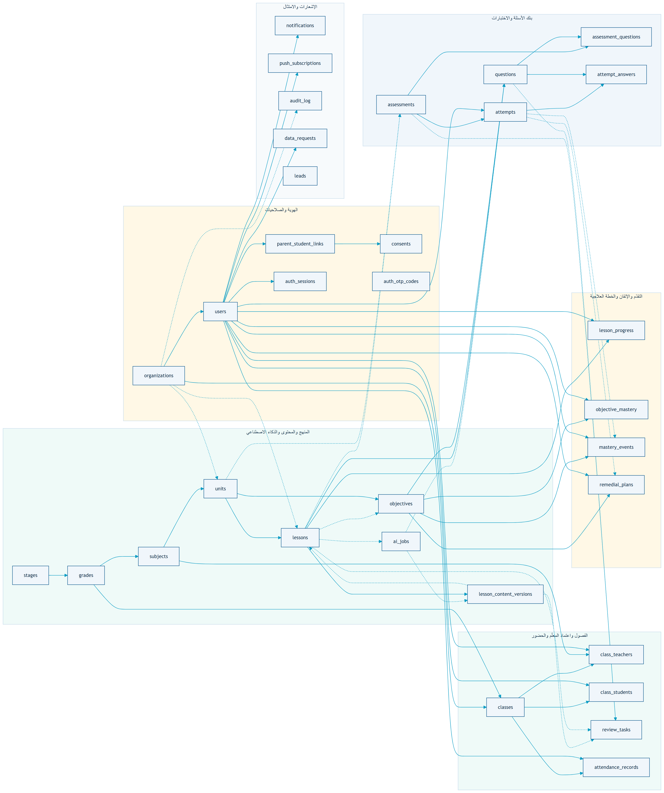
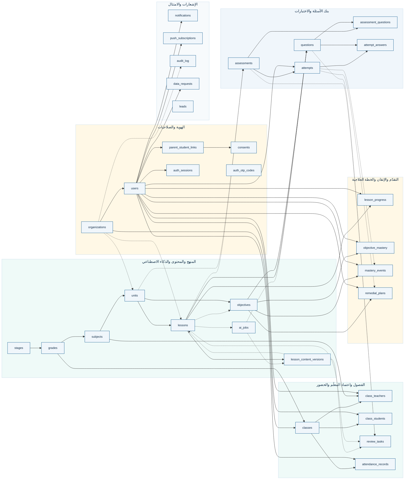
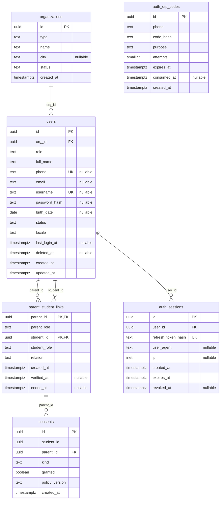
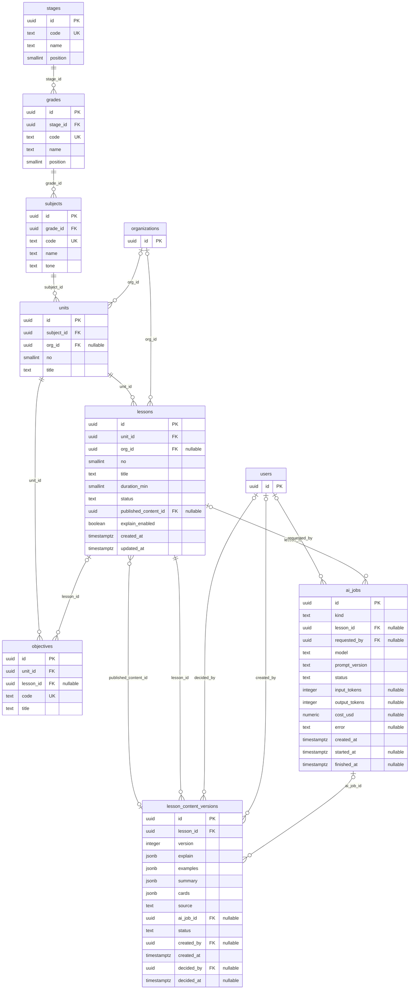
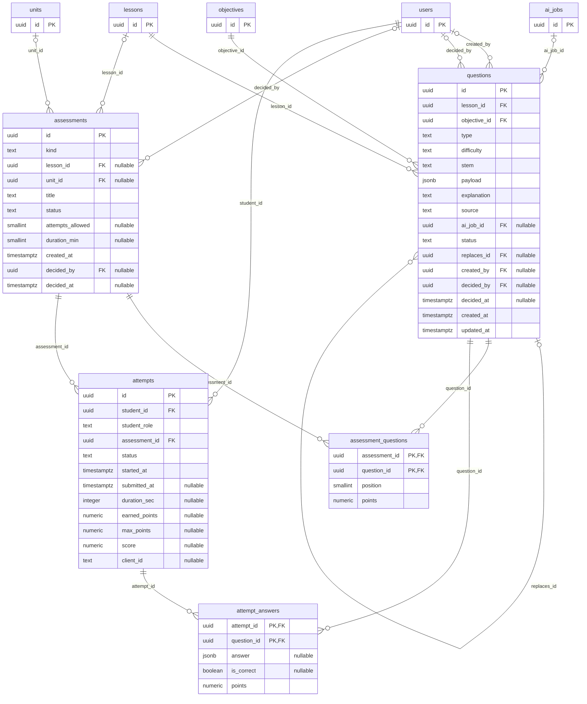
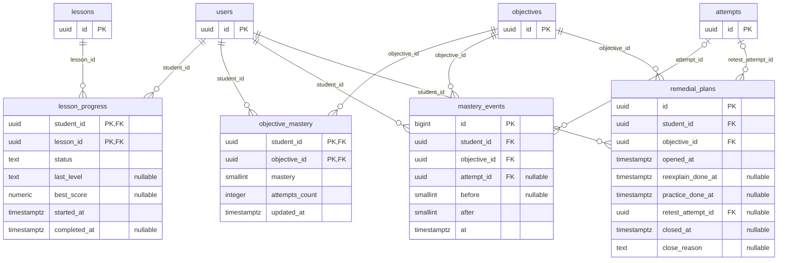
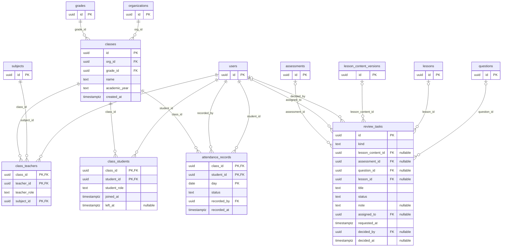
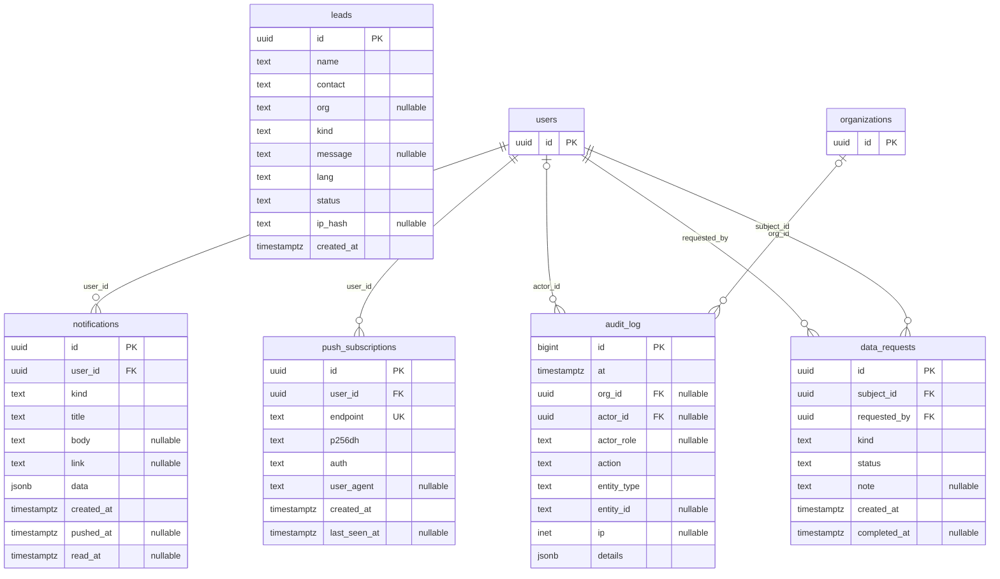

# مخطّط الكيانات والعلاقات (ERD) — قاعدة بيانات الـMVP

> مولَّد تلقائيًّا من [`schema.sql`](schema.sql) بعد تحميله في PostgreSQL فعلي، فكل جدول وعمود ومفتاح وعلاقة هنا هو ما في المخطّط حرفيًّا: **33 جدولًا و67 علاقة**. الشرح والقرارات في [`database.md`](database.md).
>
> **الملف الكامل في SVG واحد:** [`erd/mushriq-erd.svg`](erd/mushriq-erd.svg) (النظرة العامة + المخطّطات الستة، قابل للتكبير). ونسخة كل مخطّط على حدة (SVG وPNG) في [`erd/`](erd/)، و[`erd/full.svg`](erd/full.svg) فيه كل الجداول والعلاقات في رسمة واحدة غير مقسّمة.

**قراءة الرموز:** `PK` مفتاح أساسي · `FK` مفتاح أجنبي · `UK` قيمة فريدة · `nullable` يقبل الفراغ.
في مخطّطات المجالات: الخط `||--o{` يعني «واحد إلى كثير» والأصل إلزامي، و`|o--o{` يعني أن الأصل اختياري. الجداول التي تظهر بعمود `id` وحده تنتمي إلى مجال آخر وتظهر هنا لتوضيح العلاقة.

## الفهرس

1. [نظرة عامة](#نظرة-عامة)
2. [الهوية والصلاحيات](#الهوية-والصلاحيات)
3. [المنهج والمحتوى والذكاء الاصطناعي](#المنهج-والمحتوى-والذكاء-الاصطناعي)
4. [بنك الأسئلة والاختبارات](#بنك-الأسئلة-والاختبارات)
5. [التقدّم والإتقان والخطة العلاجية](#التقدّم-والإتقان-والخطة-العلاجية)
6. [الفصول واعتماد المعلّم والحضور](#الفصول-واعتماد-المعلّم-والحضور)
7. [الإشعارات والامتثال](#الإشعارات-والامتثال)

## نظرة عامة

الجداول مجمّعة حسب المجال، والسهم من الجدول الأصل إلى الجدول الذي يحمل المفتاح الأجنبي (المتقطّع = علاقة اختيارية). أعمدة «من نفّذ» مثل `created_by` و`decided_by` محذوفة من هذه النظرة لتبقى مقروءة، وهي ظاهرة في مخطّطات المجالات.

شيفرة Mermaid

## الهوية والصلاحيات

الجداول: `organizations`، `users`، `parent_student_links`، `consents`، `auth_otp_codes`، `auth_sessions`.

[صورة SVG](erd/identity.svg) · [صورة PNG](erd/identity.png)

## المنهج والمحتوى والذكاء الاصطناعي

الجداول: `stages`، `grades`، `subjects`، `units`، `lessons`، `objectives`، `lesson_content_versions`، `ai_jobs`. من مجالات أخرى: `organizations`، `users`.

[صورة SVG](erd/curriculum.svg) · [صورة PNG](erd/curriculum.png)

## بنك الأسئلة والاختبارات

الجداول: `questions`، `assessments`، `assessment_questions`، `attempts`، `attempt_answers`. من مجالات أخرى: `ai_jobs`، `users`، `lessons`، `objectives`، `units`.

[صورة SVG](erd/assessment.svg) · [صورة PNG](erd/assessment.png)

## التقدّم والإتقان والخطة العلاجية

الجداول: `lesson_progress`، `objective_mastery`، `mastery_events`، `remedial_plans`. من مجالات أخرى: `lessons`، `users`، `objectives`، `attempts`.

[صورة SVG](erd/progress.svg) · [صورة PNG](erd/progress.png)

## الفصول واعتماد المعلّم والحضور

الجداول: `classes`، `class_teachers`، `class_students`، `review_tasks`، `attendance_records`. من مجالات أخرى: `grades`، `organizations`، `subjects`، `users`، `assessments`، `lesson_content_versions`، `lessons`، `questions`.

[صورة SVG](erd/classes.svg) · [صورة PNG](erd/classes.png)

## الإشعارات والامتثال

الجداول: `notifications`، `push_subscriptions`، `audit_log`، `data_requests`، `leads`. من مجالات أخرى: `users`، `organizations`.

[صورة SVG](erd/ops.svg) · [صورة PNG](erd/ops.png)
